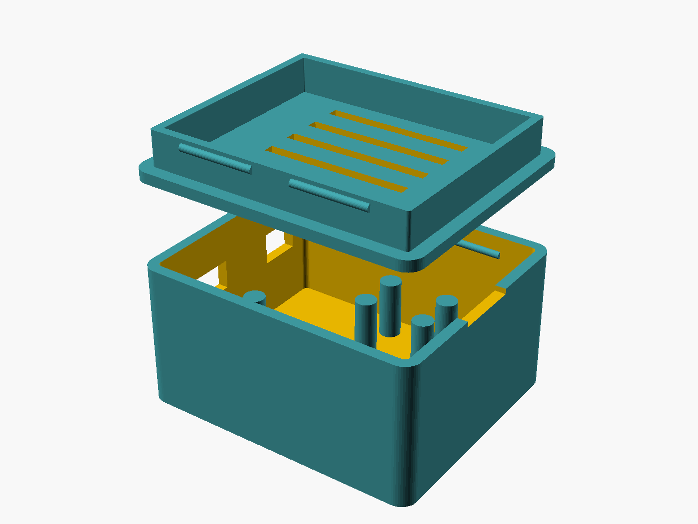

# Wavin AHC9000 → ESP32 HTTP bridge

Reads room temperatures, setpoints and heat demand from a **Wavin AHC9000** underfloor-heating
controller (OEM: Jablotron **AC-116**) over **RS-485 Modbus RTU**, and exposes them as a small
**JSON API**. Built with the **Arduino IDE** for a classic **ESP32-WROOM-32**.

Writing a client? See **[docs/API.md](docs/API.md)** — the integration guide.
Protocol source of truth: [docs/WAVIN_REGISTER_MAP.md](docs/WAVIN_REGISTER_MAP.md) — transcribed
from the OEM *AC-116 Modbus Register Map*.

Prior art worth reading for protocol validation: `dkjonas/Wavin-AHC-9000-mqtt` (ESP8266, MQTT).

---

## 1. Hardware

| Item | Notes |
|---|---|
| ESP32-WROOM-32 DevKit ("ESP-32S") | classic dual-core ESP32 |
| TTL ↔ RS-485 module | e.g. MAX485/MAX3485 breakout. **NOT** a USB-RS485 adapter |
| 120 Ω termination | only if the ESP sits at the physical end of the bus |
| Wires to the AHC9000 | RS-485 **A**, **B** and **GND** |

### ⚠️ Power / logic levels — depends on your transceiver

**The ESP32 is not 5V-tolerant.** Whatever drives `RO`/`TXD` into GPIO16 must not exceed 3.3V.

**A. Genuine MAX485 (e.g. `MAX485CSA`) — a 5V-only part (4.75–5.25V):**
power `VCC` from **5V** and drop `RO` with a divider before GPIO16:

```
MAX485 RO ──┬── 1kΩ ──┬── GPIO16
            │         │
                     2kΩ
                      │
                     GND          ->  5V x 2/(1+2) ~= 3.3V   (2.2k + 3.3k also works)
```
`DI` and `DE`/`RE` connect **directly** — they are ESP32 outputs, and 3.3V clears the MAX485's
2.0V input threshold. Note some DevKits drop the `5V`/`VIN` rail to ~4.7V over a Schottky diode
when USB-powered; usually fine, but use a real 5V supply if it is flaky.

**B. 3.3V-capable transceiver (MAX3485 / SP3485 / auto-direction modules):**
power `VCC` from **3V3** and wire `RO` straight to GPIO16 — no divider needed.

Running a genuine MAX485 at 3.3V (no divider) is the common hobby shortcut and often works on a
short bus, but it is **out of spec** — fine as a quick test, not for the final install. Watch
`modbusErr` in `/health`.

### Wiring

| RS-485 module | ESP32 | Purpose |
|---|---|---|
| `RO` / `TXD` | **GPIO16** (RX2) | ESP receives ← bus |
| `DI` / `RXD` | **GPIO17** (TX2) | ESP transmits → bus |
| `DE` + `RE` *(manual modules only)* | **GPIO4** | direction; omit on auto-direction modules |
| `VCC` | **3V3** *or* **5V** | see the power section above — a genuine MAX485 needs 5V **plus a divider on `RO`** |
| `GND` | GND | common ground with the bus |
| `A` / `B` | AHC9000 A / B | differential pair |

**Two module variants — check the silkscreen:**
- Pins `VCC GND TXD RXD A B` → **auto-direction**: set `AUTO_DIRECTION 1`, leave GPIO4 unused.
- Pins `RO DI RE DE VCC GND A B` → **manual**: tie `DE`+`RE` together to GPIO4, set `AUTO_DIRECTION 0`.

If reads fail, try swapping the RX/TX pair — module labelling is inconsistent between vendors.
But check `diag` in `/health` first (see [§5](#5-bring-up-order)): if bytes are arriving, your
wiring is already right and swapping it will only mislead you.

**Driver turnaround glitch.** On a manual-direction module, releasing `DE` after transmitting
leaves the line floating for an instant, which fakes a start bit and injects a spurious `0x00`
ahead of the controller's reply. The transport discards leading bytes until it sees `UNIT_ID`,
so this is handled — `diag.leadJunk` counts them, and roughly one per transaction is normal.
If it climbs much faster than that, the bus bias is weak: add proper bias resistors, or fit the
120 Ω termination if the run is long.

### Enclosure

A parametric snap-fit case for both boards lives in [`hardware/`](hardware/) — OpenSCAD source,
ready-to-print STLs, and renders of every side. See [hardware/README.md](hardware/README.md).



53.3 × 44.8 × 28.5 mm. The ESP32 and the MAX485 sit side by side on raised pads, both connectors
leave through the same short wall, and the lid clicks on — no screws. The lid is shown flipped,
the way you print it.

### Status LED

The onboard LED (**GPIO2** on most DevKits) shows the state of the **Wavin Modbus link** at a
glance — no serial cable needed:

| LED | Meaning |
|---|---|
| **Brief flash once per second** (heartbeat) | ✅ Modbus link up — talking to the AHC9000 |
| **Fast blink (5 Hz)** | ❌ No Modbus link — board is alive, but the bus is not answering |

"Link up" = a Modbus transaction succeeded within `MODBUS_OK_TIMEOUT_MS` (default: two poll
intervals + 15 s, so a single missed poll won't trip it). The same signal drives `"serial"` in
`/health`. If your board's LED is wired active-low, set `LED_ACTIVE_HIGH 0` in `config.h`.

---

## 2. Arduino IDE setup

1. **Board support** — `File → Preferences → Additional Boards Manager URLs`:
   `https://raw.githubusercontent.com/espressif/arduino-esp32/gh-pages/package_esp32_index.json`
   then `Tools → Board → Boards Manager` → install **esp32 by Espressif**.
2. **Board** — `Tools → Board → ESP32 Arduino → ESP32 Dev Module`. Select your `Port`.
3. **Libraries** — `Tools → Manage Libraries` → install **ArduinoJson** (v6 or v7, both
   supported) and **PicoMQTT** (only if `MQTT_ENABLE` is 1 — see [§6](#6-mqtt-broker)).
   `WiFi`, `WebServer`, `ESPmDNS` and `ArduinoOTA` ship with the ESP32 core.
4. **Secrets** — copy `WavinEsp32/secrets.h.example` to `WavinEsp32/secrets.h` and fill in your
   WiFi credentials and an API token. `secrets.h` is gitignored.
5. Open `WavinEsp32/WavinEsp32.ino` and **Upload**. Serial Monitor at **115200**.

---

## 3. Configuration

All in `WavinEsp32/config.h`:

| Setting | Default | Meaning |
|---|---|---|
| `AUTO_DIRECTION` | `0` | 0 = manual DE/RE on `DE_PIN`, 1 = auto module (no DE pin) |
| `DE_PIN` / `RXD2` / `TXD2` | 4 / 16 / 17 | RS-485 pins |
| `WAVIN_SERIAL_CFG` | `SERIAL_8N1` | **OEM spec is 8N1**; try `SERIAL_8N2` only if `diag.crcFail` is climbing. A receiver set to 8N1 reads an 8N2 stream fine, so this is rarely the fault |
| `RESPONSE_TIMEOUT` | `300` | ms; also the worst-case time one failed read can block `loop()` |
| `UNIT_ID` | `1` | every AHC9000 answers at logical address 1 |
| `ELEMENT_COUNT` | `10` | how many element pages to scan (max 48) |
| `POLL_INTERVAL_MS` | `30000` | time for one **full sweep**; one element is polled every `POLL_INTERVAL_MS / ELEMENT_COUNT` |
| `FAIL_THRESHOLD` / `FAIL_BACKOFF_MS` | 3 / 5 min | park an element after N consecutive failures |
| `MDNS_NAME` | `wavin` | → `http://wavin.local` |
| `LED_PIN` / `LED_ACTIVE_HIGH` | 2 / 1 | status LED; set 0 for active-low boards |
| `MODBUS_OK_TIMEOUT_MS` | 2×poll+15s | how long without a good read before "link down" |
| `RELAY_OVERRIDE_DEFAULT_S` / `_MAX_S` | 30 min / 4 h | relay suppression deadline and hard cap |
| `MQTT_ENABLE` / `MQTT_PORT` | 1 / 1883 | embedded broker; 0 compiles it and PicoMQTT out |
| `MQTT_REQUIRE_AUTH` | `0` | require `MQTT_USER`/`MQTT_PASS` from `secrets.h` on connect |
| `MQTT_MAX_TOPICS` / `_TOPIC_LEN` / `_PAYLOAD_LEN` | 16 / 64 / 512 | cache size, statically allocated (~9 kB) |
| `MQTT_MAX_MESSAGE_LEN` | `1024` | hard ceiling on one MQTT message; larger are dropped |

---

## 4. HTTP API

Reads are served from the in-memory cache refreshed by the poll loop, so they are instant and keep
the RS-485 bus quiet. Writes go straight to the controller, then refresh that room.

```
GET http://wavin.local/health
→ {"status":"ok","serial":"up","rooms":10,"lastPollMs":4210,"uptimeS":3600,
   "ip":"192.168.0.42","rssi":-58,"modbusOk":420,"modbusErr":3,"chipTemp":48.3}

GET http://wavin.local/rooms
→ [ {"id":1,"syncGroup":3,"current":22.4,"desired":21.0,"manual":21.0,"floor":23.1,
     "mode":"manual","output":true,"alive":true,"lowBattery":false,
     "humidity":41,"battery":80,"rssi":-61.5,"rssiUnit":-58.0,"cooling":false}, ... ]

GET http://wavin.local/rooms/1        → a single room object
```

**Control** (requires the token header):

```bash
curl -X POST http://wavin.local/rooms/1 \
     -H "X-Api-Token: your-token" \
     -H "Content-Type: application/json" \
     -d '{"manualTemp":21.5}'

curl -X POST http://wavin.local/rooms/1 \
     -H "X-Api-Token: your-token" \
     -H "Content-Type: application/json" \
     -d '{"mode":"manual"}'      # manual | standby | eco | comfort | schedule
                                 # temp-eco | temp-comfort | party | holiday

curl -X POST http://wavin.local/rooms/1 \
     -H "X-Api-Token: your-token" \
     -H "Content-Type: application/json" \
     -d '{"comfortTemp":22,"ecoTemp":19}'   # also standbyTemp, holidayTemp, partyTemp

curl -X POST http://wavin.local/rooms/1 \
     -H "X-Api-Token: your-token" \
     -H "Content-Type: application/json" \
     -d '{"mode":"party","partyTemp":24,"durationMin":180}'   # 24 °C for 3 h

curl -X POST http://wavin.local/rooms/1 \
     -H "X-Api-Token: your-token" \
     -H "Content-Type: application/json" \
     -d '{"cooling":true}'       # invert the control loop for this room
```

**`cooling`** sets the room's `COOL MODE` bit, which **inverts the control loop**: the actuator
opens when the room is *above* setpoint instead of below. Written with a masked write, so the
room's mode, lock and floor settings are preserved. See [Heat redistribution](#8-heat-redistribution).

> **`Content-Type: application/json` is required.** The ESP32 `WebServer` parses
> `application/x-www-form-urlencoded` bodies into form args instead of exposing the raw JSON, so
> omitting the header makes the body unreadable (you'd get `400 bad_json`).

Errors: `{"error":"...","message":"..."}` with `400` validation, `401` bad token, `404` unknown
room, `409` Modbus write failed.

Mode changes use the OEM **masked write (0x45)** so only `MODE[2:0]` + `SCHED ENA` are touched —
the lock/floor/cooling bits are preserved and there is no read-modify-write race.

**Party** and **holiday** write `MODE[2:0]` only and keep `SCHED ENA`, so a scheduled room goes
to the with-schedule variant and returns to its schedule afterwards. The controller runs the timer
itself. `partyTemp`, `holidayTemp` and `durationMin` are optional and written before the mode
switch; see [docs/API.md](docs/API.md#party-and-holiday).

**Relays** — one drives the circulation pump, one signals the heat source:

```bash
curl http://wavin.local/relays

curl -X POST http://wavin.local/relays/2 \
     -H "X-Api-Token: your-token" -H "Content-Type: application/json" \
     -d '{"enabled":false,"restoreAfterS":1800}'   # suppress the call for heat, 30 min
```

Suppressing a relay clears its assignment map, which is **non-volatile on the controller**. Every
override is therefore time-limited (default 30 min, hard cap 4 h), persisted to NVS so a reboot
restores it, and auto-restored on-device. See [§8](#8-heat-redistribution) and
[docs/API.md](docs/API.md).

Full client-facing contract: **[docs/API.md](docs/API.md)**.

---

## 5. Bring-up order

Do these in order — the protocol is the risky part, so prove it read-only first.

1. **Flash and watch the Serial Monitor.** On boot it prints the RS-485 config, the IP, and the
   result of the first poll. If you see rooms with sane temperatures, the wiring and codec work.
2. **No rooms found?** Don't guess at wiring — read `diag` in `/health` first. It splits failures
   into categories that point at completely different faults, and swapping wires blind can turn a
   working setup into a broken one:

   ```
   curl http://wavin.local/health | python3 -m json.tool
   ```

   | What `diag` shows | What it means | What to do |
   |---|---|---|
   | `silent` climbing, `rxBytes: 0` | Nothing on the wire at all | DE/direction, A/B polarity, wiring, power. **Framing changes cannot help here** |
   | `crcFail` climbing, `rxBytes` > 0 | Bus is talking, bytes are mangled | Read `longestFrame`; try `SERIAL_8N2`; suspect noise or termination |
   | `runt` climbing | Fragments only | Look at `longestFrame` — usually a real reply truncated by a glitch byte |
   | `badFrame` climbing | Valid frame, wrong content | Protocol-level: check `UNIT_ID` and the register map |

   **`longestFrame` is the single most useful field.** A healthy AHC9000 reply starts `01 43`
   (unit id, function code) followed by a byte count. If you can see that pattern anywhere in the
   dump, your wiring, baud and framing are all *already correct* and the problem is elsewhere.
   `leadJunk` counting up ~once per transaction is normal and harmless — see below.

   Remember each element is parked for `FAIL_BACKOFF_MS` (5 min) after `FAIL_THRESHOLD` failures,
   so **reboot after every change** and read `/health` within ~90 s. Otherwise you are looking at a
   backed-off bus and will conclude nothing changed.

   Only if `diag` says nothing is arriving: swap RX/TX; verify `AUTO_DIRECTION` matches your
   module; confirm the module's supply and the `RO` divider; check A/B polarity.
3. **Verify over HTTP:** `curl http://wavin.local/health` and `curl http://wavin.local/rooms`.
4. **Test one write** on a single room with the `curl` above, and confirm the thermostat reflects it.
5. Only then wire it into the gateway.

---

## 6. MQTT broker

The bridge runs a small MQTT broker on **port 1883**. Devices publish to it, the last
payload per topic is cached in RAM, and the cache is served over REST at `/mqtt` — so a
client that already talks to this API gets the extra data without speaking MQTT.

Requires the **PicoMQTT** library (`Tools → Manage Libraries`). Costs about 16 kB of flash
and 9.6 kB of RAM; set `MQTT_ENABLE 0` in `config.h` to compile it out entirely.

⚠️ **This is a broker of convenience, not infrastructure.** Nothing is persisted, there is
no TLS, and every client drops when the bridge reboots or takes an OTA update. Don't put
anything on it that the heating depends on. If you already run Mosquitto or Home Assistant,
publish there instead — this exists so a couple of sensors don't require a second box.

The cache is bounded on purpose (`MQTT_MAX_TOPICS` × `MQTT_MAX_PAYLOAD_LEN`, statically
allocated): a broker accepts whatever the network sends it, and an unbounded cache would be
one hostile publisher away from taking the heating offline. Oversized payloads are stored
truncated and the fullest table evicts its least recently updated topic — both are counted
under `mqtt` in `/health`, along with `freeHeap`, so you can see it rather than guess.

### Watts Live

[Watts Live](https://watts.zendesk.com/hc/da/articles/10271861655580-Brug-Watts-Live-sammen-med-Home-Assistant)
publishes to `watts/<serial>/measurement` — a JSON object of roughly 400 bytes carrying
`positive_active_power`, `voltage_l1..l3`, `current_l1..l3`, the energy registers and so on.
The defaults in `config.h` are sized for exactly that.

Point it at the bridge over BLE (nRF Connect), per the Watts guide:

| Setting | Value |
|---|---|
| Hostname | the bridge's **IP address** — not `wavin.local`; give it a DHCP reservation |
| Port | `1883` |
| Username / Password | leave empty, unless you set `MQTT_REQUIRE_AUTH 1` |

Then watch it arrive:

```sh
curl http://wavin.local/mqtt | python3 -m json.tool
```

Watts Live cannot do TLS — the Watts guide says so explicitly — so credentials and readings
cross the LAN in clear text. `MQTT_REQUIRE_AUTH` (with `MQTT_USER` / `MQTT_PASS` in
`secrets.h`) keeps stray devices out; it is not a security boundary.

Note `ageMs` in the response. A silent device keeps returning its last reading forever, so
freshness is the client's job — see [docs/API.md](docs/API.md).

---

## 7. Layout

```
WavinEsp32/
├── WavinEsp32.ino     setup/loop, WiFi, mDNS, OTA, poll scheduler
├── config.h           pins, serial, poll interval, mDNS name
├── secrets.h          WiFi + API token (gitignored; copy from .example)
├── wavin_modbus.*     RS-485 transport: CRC16, framing, 0x43/0x44/0x45
├── wavin_domain.*     register constants + element/room decode, control
├── relay_control.*    pump / heat-source relay override, with auto-restore
├── status_led.*       onboard LED shows the Modbus link state
├── mqtt_broker.*      embedded MQTT broker + last-value cache
└── http_api.*         WebServer routes and JSON serialisation
docs/
├── API.md                  integration guide for the controlling application
└── WAVIN_REGISTER_MAP.md   full OEM register map and function codes
hardware/
├── esp32_max485_case.scad  snap-fit enclosure, parametric
├── *.stl                   exported base + lid, ready to print
├── render.sh               regenerates renders/ from the .scad
└── README.md               dimensions, views, printing notes
```

---

## 8. Beyond the basics

The controller supports far more than this bridge currently uses — DHW setpoints and cleaning
schedule, high-temp cutoff, per-room floor limits / alarms / hysteresis, cooling mode, relay and
pump control, per-channel and total power, week schedules, change-flag polling and thermostat
pairing. All of it is documented in [docs/WAVIN_REGISTER_MAP.md](docs/WAVIN_REGISTER_MAP.md); the
`wavin_modbus` layer can already read and write any of it.

## 9. Heat redistribution

`COOL MODE` can be used to move heat between rooms rather than to cool the house: put an
over-warm room (solar gain, wood stove, south-facing) into cooling so its loop *absorbs* heat into
the circulating water, and leave the cold rooms in normal heating so they *release* it. The floor
slab becomes a heat exchanger and the manifold the transfer bus.

**The one condition that decides whether it works:** heat only flows into the water if the water is
**cooler than the warm room**. So:

- The **circulation pump must run** (otherwise nothing moves).
- The **heat source must be off**, or supplying water below the warm room's temperature. If the
  heat pump is pushing 30 °C water while the warm room is 24 °C, opening that room's valve in
  cooling mode *heats it further* - the exact opposite of the intent.

In other words this is a **pump-on / heat-off** mode. Practically: when you detect
`room A > target` and `room B < target`, set A to `cooling:true`, ensure B is heating, and make
sure the heat source is paused while the pump circulates. Reverse A back to `cooling:false`
afterwards.

Condensation is **not** a concern here (unlike real cooling with chilled water) because the
circulating water sits at room temperature. The elements still report `dewPoint` and `humidity` if
you ever want to guard against it.

Expect modest, slow transfer - it is limited by loop length, flow rate and the small temperature
difference between rooms. Treat it as gentle evening-out, not as room-to-room air conditioning.
