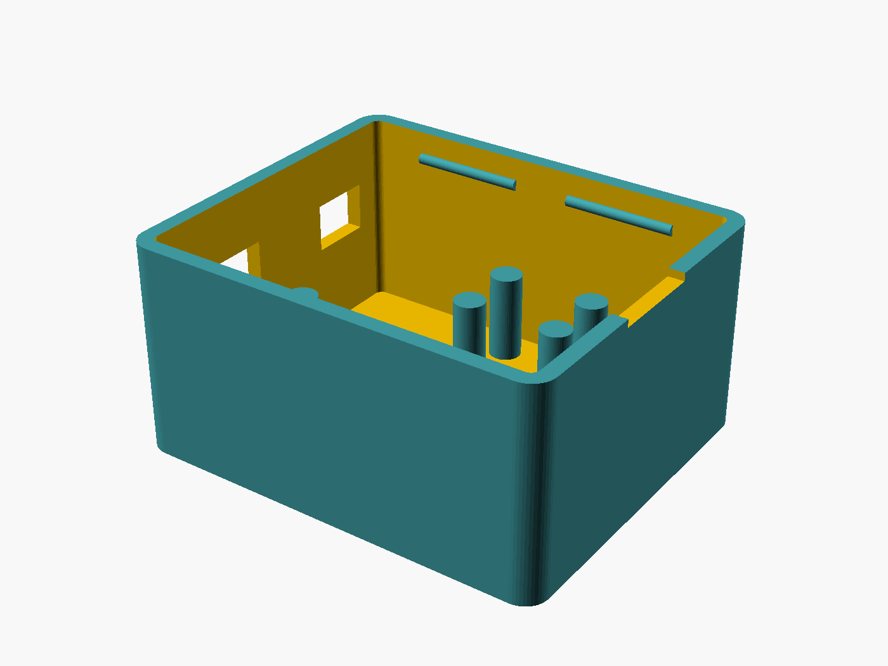
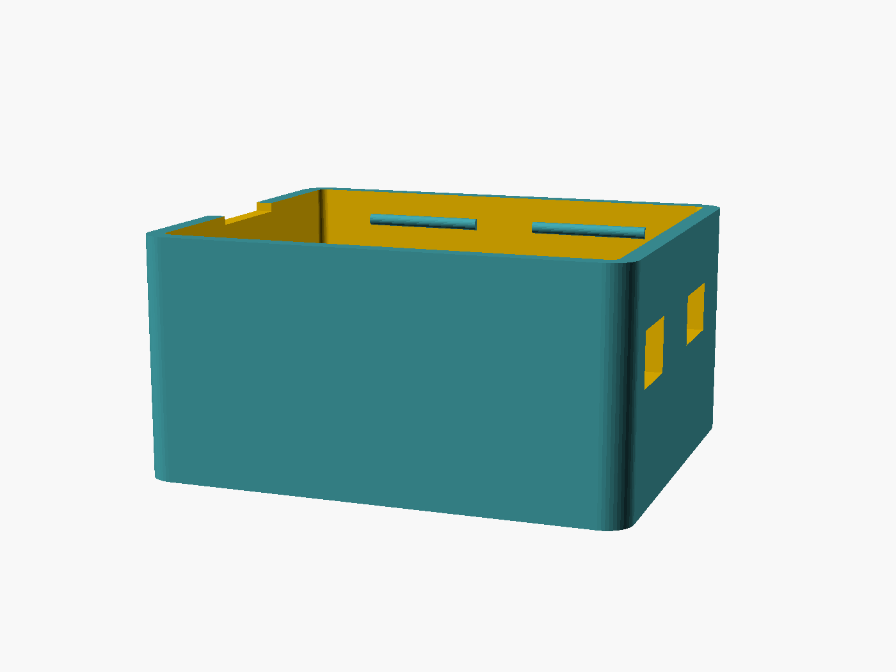
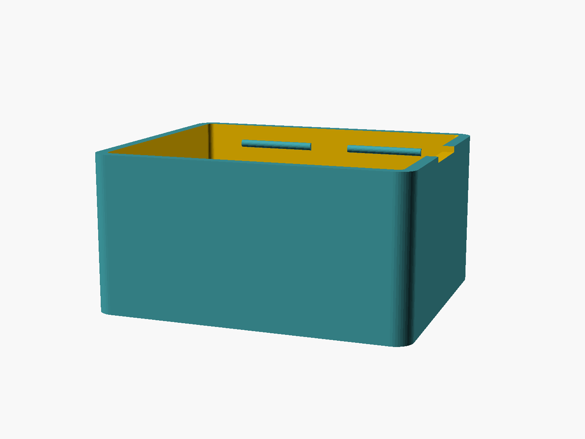
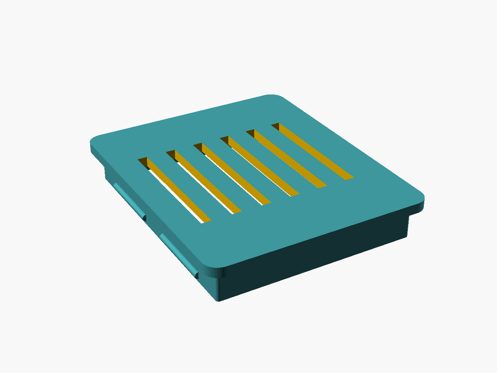

# Enclosure

Snap-fit two-part case for the bridge: an ESP32 DevKit and a MAX485 module side by side,
both connectors leaving through the same wall.

| | |
|---|---|
| Footprint | 53.3 × 44.8 mm |
| Height, assembled | 28.5 mm |
| Wall / floor / lid | 2.0 mm |
| Board clearance above floor | 11.0 mm |
| Fit clearance around boards | 0.4 mm |

Source: [`esp32_max485_case.scad`](esp32_max485_case.scad). Exported meshes:
[`esp32_max485_case_base.stl`](esp32_max485_case_base.stl) ·
[`esp32_max485_case_lid.stl`](esp32_max485_case_lid.stl).

## Views

Set `part` at the top of the `.scad` to `"base"`, `"lid"`, or `"both"` (exploded preview).


The lid is shown flipped and floating above the base — the same orientation you print it in,
skirt and catch ridges facing up.



Two glue pads raise the boards 11 mm off the floor, which clears the downward header pins and
their Dupont housings. The long pad carries the ESP32; the four clustered posts take the MAX485,
deliberately short and shifted away from the cable exit so the header pins have room.



Both openings share the low-X short wall: a 9 × 5.5 mm micro-USB window for the ESP32, and an
8 × 6 mm slot for the RS-485 cable.



The opposite wall is blank apart from the pry notch, bitten 1 mm into the rim so a fingernail
or a small tool can lever the lid off.



Six ventilation slots through the top plate. The 1.6 mm skirt flexes to snap under the catch
ridges moulded into the base's inner walls.

## Printing

No supports needed — every overhang is either bridged or chamfered. Print the lid skirt-up as
shown in the exploded view; the catch ridges are the one feature that may want a slower first
layer. `snap_r` (default 0.7 mm) sets how far the catches protrude: increase for a firmer click,
decrease if the lid is hard to open.

## Regenerating the renders

The images in `renders/` are generated, not hand-exported. After changing the `.scad`:

```sh
./render.sh          # needs the OpenSCAD CLI on PATH
```

Note the dimensions above are derived from the source parameters. The STLs are committed
separately, so re-export them too if you change anything geometric.
